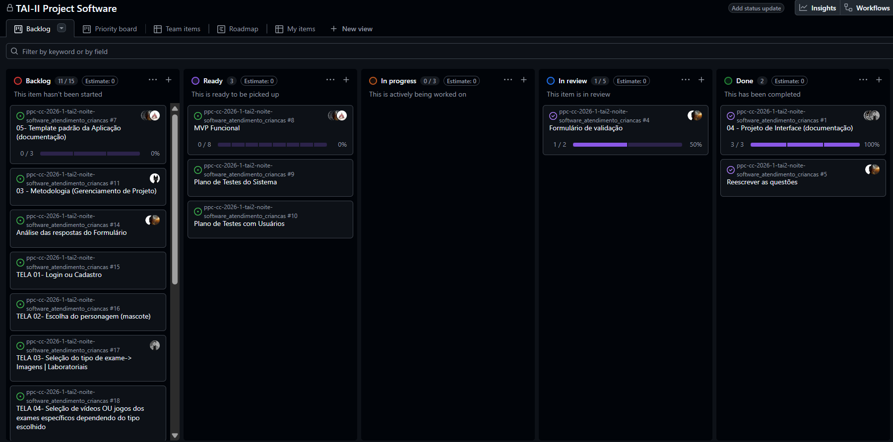

# Metodologia

## Gerenciamento de Projeto
A metodologia ágil escolhida para o desenvolvimento deste projeto foi o Kanban, por sua simplicidade e flexibilidade, que ajudam a otimizar o fluxo de trabalho e aumentar a produtividade. Através de um sistema visual de organização das tarefas, é possível acompanhar o andamento do projeto em tempo real, identificar prioridades e possíveis gargalos, além de facilitar a colaboração da equipe. Dessa forma, o Kanban contribui para um processo de desenvolvimento mais organizado, eficiente e contínuo.

### Divisão de Papéis

A equipe utiliza o Kanbam como base para definição do processo de desenvolvimento.

- Kanbam Master:
```
├── Maria Clara de Carvalho Sousa Bertozi
```
- Product Owner:
```
├── Clara Freitas de Oliveira
├── Maria Clara de Carvalho Sousa Bertozi
```
- Equipe de Desenvolvimento:
```
├── Alexsandro Bueno
├── Clara Freitas de Oliveira
├── Gustavo Vilas Boas Pereira
├── José Carvalho Neto
├── Lucas Caiaffa Paschoalini
├── Maria Clara de Carvalho Sousa Bertozi
```
- Equipe de Design:
```
├── Clara Freitas de Oliveira
├── José Carvalho Neto
├── Maria Clara de Carvalho Sousa Bertozi
```

### Processo

A equipe utilizará o GitHub Projects com o método Kanban para organizar e acompanhar o desenvolvimento do projeto. O quadro será usado para gerenciar tarefas, visualizar o progresso e acompanhar o status de cada atividade. Abaixo está a estrutura adotada, seguida de um print do Kanban do projeto.

```
├── Backlog: lista com todas as tarefas do projeto, incluindo novas que surgirem. Nem todos os membros
    estão ligados a tarefas ainda.
├── Ready: tarefas prontas para começar.
├── In Progress: tarefas em andamento.
├── In Review: tarefas em revisão.
├── Done: tarefas finalizadas e prontas para entrega.
```

<figure>
  
  <figcaption>Figura 1 - Kanban do Projeto</figcaption>
</figure>

### Etiquetas
<p>As tarefas são, ainda, etiquetadas em função da natureza da atividade e seguem o seguinte esquema de cores/categorias:</p>

<ul>
  <li>Bug (Erro no código)</li>
  <li>Desenvolvimento (Development)</li>
  <li>Documentação (Documentation)</li>
  <li>Gerência de Projetos (Project Management)</li>
  <li>Infraestrutura (Infrastructure)</li>
  <li>Testes (Tests)</li>
</ul>

<figure> 
  Figura 2 - Tela do esquema de cores e categorias</figcaption>
</figure> 
  
### Ferramentas

Os artefatos do projeto são desenvolvidos a partir de diversas plataformas e a relação dos ambientes com seu respectivo propósito é apresentada na tabela que se segue.

| AMBIENTE                            | PLATAFORMA                         | LINK DE ACESSO                         |
|-------------------------------------|------------------------------------|----------------------------------------|
| Repositório de código fonte         | GitHub                             | [ Código fonte ](https://github.com/ICEI-PUC-Minas-PPC-CC/ppc-cc-2026-1-tai2-noite-software_atendimento_criancas/tree/main/codigo-fonte)                          |
| Documentos do projeto               | GitHub                             | [ Documentos ](https://github.com/ICEI-PUC-Minas-PPC-CC/ppc-cc-2026-1-tai2-noite-software_atendimento_criancas/tree/main/documentos)                            |
| Gerenciamento do Projeto            | GitHub Projects                    | [ GitHub Projects ](https://github.com/orgs/ICEI-PUC-Minas-PPC-CC/projects/186/views/1)                      |
| Prototipo de baixa fidelidade       | Canvas                             | [ Canvas ](https://www.canva.com/design/DAHGS6csi_c/lj-5cdHHTSn0_w2MQtzprA/edit?utm_content=DAHGS6csi_c&utm_campaign=designshare&utm_medium=link2&utm_source=sharebutton)                           |
| User Flow                           | Miro                               | [ User Flow ](https://miro.com/app/board/uXjVGlDmu5g=/?share_link_id=383315239290)                            |
| Mapa de Solução                     | Miro                               | [ Mapa de Solução ](https://miro.com/pt/jointheteam/Vm9SdUI0NHZ4cEFjbzdnNUJJc0hnMDVwQnNha215Nmpqc3JjeEZCdm53c0FqS3VNdlFYUzlhem5Kelo3V1VwQW4vbUZsUml1ZHk5K3FDemFNazY1b2wzNWh6ekNiNk1VL0JZOExydDNvVDUvZTRGSGYwMHF5UmsrRzlUTVViSHlnbHpza3F6REdEcmNpNEFOMmJXWXBBPT0hdjE=/)                            |
| Banco de Dados                      | XAMPP / phpMyAdmin                 | [ Banco de Dados ](https://github.com/ICEI-PUC-Minas-PPC-CC/ppc-cc-2026-1-tai2-noite-software_atendimento_criancas/tree/main/codigo-fonte/src/Backend/htdocs/medikids)                           |
| Jogo interativo                     | VsCode (html)                      | [ Jogo interativo ](https://github.com/ICEI-PUC-Minas-PPC-CC/ppc-cc-2026-1-tai2-noite-software_atendimento_criancas/tree/main/codigo-fonte/src/Game/Dr.Lumen)                            |
| Hospedagem                          | Local no XAMPP                     | [ Banco de Dados ](https://github.com/ICEI-PUC-Minas-PPC-CC/ppc-cc-2026-1-tai2-noite-software_atendimento_criancas/tree/main/codigo-fonte/src/Backend/htdocs/medikids)                                                      |

### Estratégia de Organização de Codificação

Todos os artefatos relacionados à implementação e visualização dos conteúdos do projeto do site esetão inseridos na pasta [codigo-fonte]([http://....](https://github.com/ICEI-PUC-Minas-PPC-CC/ppc-cc-2026-1-tai2-noite-software_atendimento_criancas/tree/main/codigo-fonte)). 

A organização do código-fonte segue uma estrutura modular, separando o projeto por **telas/páginas do site**, **backend** e **jogo interativo**, conforme detalhado abaixo:

```
codigo-fonte/
└── src/
    ├── Backend/htdocs/medikids   → Backend da aplicação (PHP), hospedado via XAMPP/htdocs
    ├── Game/Dr.Lumen              → Jogo interativo "Dr. Lumen"
    ├── recentes                   → Tela de conteúdos/exames acessados recentemente
    ├── selecao                    → Tela de seleção (personagem/tipo de exame)
    ├── tela_conclusao             → Tela de conclusão/resultado da explicação
    ├── tela_de_escolhas-0.1       → Tela de escolha entre vídeo ou jogo
    ├── tela_login                 → Tela de login/identificação do usuário
    ├── tela_personagens           → Tela de seleção de personagem
    └── README.md                  → Documentação de apoio ao código-fonte
```

**Critério de organização:** cada pasta representa uma tela ou módulo funcional independente do site, contendo seus próprios arquivos de HTML, CSS e/ou JavaScript específicos daquela tela. 
O arquivo  [styles.css]([https://github.com/ICEI-PUC-Minas-PPC-CC/ppc-cc-2026-1-tai2-noite-software_atendimento_criancas/tree/main/codigo-fonte](https://github.com/ICEI-PUC-Minas-PPC-CC/ppc-cc-2026-1-tai2-noite-software_atendimento_criancas/blob/main/codigo-fonte/src/Backend/htdocs/medikids/css/style.css)) (identidade visual padrão) é compartilhado entre as telas, conforme descrito na seção de Template Padrão da Aplicação. 
O **Backend** concentra a lógica de servidor (PHP) e a integração com o banco de dados (XAMPP/phpMyAdmin), enquanto o **Game** reúne os artefatos do jogo interativo Dr. Lumen, mantido separado por ter um escopo de desenvolvimento próprio.

---

### Divisão de responsabilidades por tela

Cada tela do site foi desenvolvida individualmente por um integrante do grupo, sendo posteriormente integrada ao Backend (pasta [Backend/htdocs/medikids](https://github.com/ICEI-PUC-Minas-PPC-CC/ppc-cc-2026-1-tai2-noite-software_atendimento_criancas/tree/main/codigo-fonte/src/Backend/htdocs/medikids)) para conexão com o banco de dados.

| Pasta / Tela                | Responsável pela implementação |
|------------------------------|-------------------------------|
| [Backend/htdocs/medikids](https://github.com/ICEI-PUC-Minas-PPC-CC/ppc-cc-2026-1-tai2-noite-software_atendimento_criancas/tree/main/codigo-fonte/src/Backend/htdocs/medikids)      | Gustavo Vilas Boas Pereira |
| [Game/Dr.Lumen](https://github.com/ICEI-PUC-Minas-PPC-CC/ppc-cc-2026-1-tai2-noite-software_atendimento_criancas/tree/main/codigo-fonte/src/Game/Dr.Lumen)                 | Lucas Caiaffa Paschoalini |
| [recentes](https://github.com/ICEI-PUC-Minas-PPC-CC/ppc-cc-2026-1-tai2-noite-software_atendimento_criancas/tree/main/codigo-fonte/src/recentes)                      | Gustavo Vilas Boas Pereira |
| [selecao](https://github.com/ICEI-PUC-Minas-PPC-CC/ppc-cc-2026-1-tai2-noite-software_atendimento_criancas/tree/main/codigo-fonte/src/selecao)                       | Clara Freitas de Oliveira |
| [tela_conclusao](https://github.com/ICEI-PUC-Minas-PPC-CC/ppc-cc-2026-1-tai2-noite-software_atendimento_criancas/tree/main/codigo-fonte/src/tela_conclusao)                | Alexsandro Bueno |
| [tela_de_escolhas-0.1](https://github.com/ICEI-PUC-Minas-PPC-CC/ppc-cc-2026-1-tai2-noite-software_atendimento_criancas/tree/main/codigo-fonte/src/tela_de_escolhas-0.1)          | Lucas Caiaffa Paschoalini |
| [tela_login](https://github.com/ICEI-PUC-Minas-PPC-CC/ppc-cc-2026-1-tai2-noite-software_atendimento_criancas/tree/main/codigo-fonte/src/tela_login)                 | José Carvalho Neto |
| [tela_personagens](https://github.com/ICEI-PUC-Minas-PPC-CC/ppc-cc-2026-1-tai2-noite-software_atendimento_criancas/tree/main/codigo-fonte/src/tela_personagens)              | Maria Clara de Carvalho Sousa Bertozi |

> Após a implementação individual, todas as telas foram integradas e conectadas ao banco de dados centralizado na pasta `Backend/htdocs/medikids` .
